# Rapport d’usage de l’IA : TP1, TP2 et TP3

J’ai réalisé les TP1, TP2 et TP3 individuellement. J’ai utilisé un assistant IA pour analyser le projet, compléter le code Angular et préparer les tests. Pour chaque mission, je présente ma demande, les modifications obtenues et les résultats des vérifications. Les exemples de prompts résument mes demandes pour chaque mission.

| Mission | TP | Contenu |
|---|---|---|
| 0 | TP1 | Cartographie et flux de connexion |
| 1 | TP1 | Inscription, connexion et profil |
| 2 | TP2 | Bibliothèque paginée |
| 3 | TP2 | Upload, validation et lecture audio |
| 5 | TP3 | Suppression d’une piste |
| 6 | TP3 | Progression de l’upload |
| 7 | TP3 | Tests automatisés |

## Mission 0 : Cartographie de l’application (TP1)

**Objectif.** Comprendre le trajet d’une requête avant de modifier l’application.

### Fichiers et responsabilités

Les chemins frontend ci-dessous sont relatifs à `frontend-starter/`.

| Élément | Fichier ou dossier | Responsabilité |
|---|---|---|
| Démarrage Angular | `src/main.ts` | `bootstrapApplication(AppComponent)` démarre l’application standalone, `provideRouter(routes)` configure la navigation |
| Composant racine | `src/app/components/app/app.ts` et `app.html` | `AppComponent` affiche la navigation et le point d’insertion des pages |
| Routes | `src/app/routes.ts` | Pages `/login`, `/register`, `/profile`, `/tracks`, profil et bibliothèque protégés par `authGuard` |
| Configuration HTTP | `src/main.ts` | `provideHttpClient(withXhr(), withInterceptors([authInterceptor]))` enregistre `HttpClient`, le transport XHR et l’intercepteur |
| Pages | `src/app/components/` | Formulaires, actions utilisateur et affichage |
| Modèles TypeScript | `src/app/shared/models/` | Types `User`, `AuthResponse`, `Track` et `Page`, ils ne sont pas des connexions à MongoDB |
| Services | `src/app/shared/services/auth.service.ts` et `track.service.ts` | Centralisent les appels HTTP, `AuthService` conserve aussi l’état d’authentification |
| Intercepteur JWT | `src/app/shared/interceptors/auth.interceptor.ts` | Ajoute `Authorization: Bearer …` si un token existe, nettoie la session et redirige vers `/login` après un 401 |
| Guard | `src/app/shared/guards/auth.guard.ts` | Autorise la navigation protégée si `auth.token()` existe, sinon renvoie un `UrlTree` vers `/login` |
| Proxy de développement | `proxy.conf.json` | Transmet `/api` vers `http://localhost:3000` |
| API et base de données | `backend/src/app.js`, `backend/src/server.js`, `backend/src/models/User.js` | Routes Express, connexion Mongoose et modèle utilisateur |

Le guard vérifie la présence du token, pas sa validité cryptographique. Le backend vérifie réellement sa signature et son expiration. L’intercepteur actuel ajoute le header à toute requête `HttpClient` lorsqu’un token existe, y compris une route publique, ces routes publiques n’exigent toutefois pas ce header. Angular ne contacte jamais directement MongoDB.

### Schéma annoté du flux de connexion

```text
Clic sur « Se connecter » : login-page.html (ngSubmit)
  → LoginPageComponent.submit() : lecture du Reactive Form
  → AuthService.login(email, password)
  → HttpClient.post('/api/auth/login', { email, password })
  → authInterceptor : ajoute Authorization seulement si un token existe déjà
  → proxy Angular /api → Express sur localhost:3000
  → POST /api/auth/login dans backend/src/app.js
  → User.findOne({ email }).select('+passwordHash') → MongoDB
  → user.verifyPassword(...) : comparaison bcrypt avec le hash
  ├─ refus : HTTP 401 { message: 'Identifiants incorrects' }
  │    → intercepteur : logout(), redirection /login
  │    → composant : message d’erreur dans le Signal error
  └─ succès : HTTP 200 { token, user: user.toPublic() }
       → tap(...) dans AuthService → storeAuthentication(response)
       → JWT dans localStorage sous la clé gpc_token
       → mise à jour des Signals token et currentUser
       → callback next du composant → redirection /tracks
       → GET /api/tracks avec Authorization pour charger la bibliothèque
```

Le formulaire et le mot de passe transitent dans la requête, mais aucune valeur de mot de passe ou de JWT ne doit figurer dans les preuves partagées. Le modèle `User` renvoie les données publiques avec `toPublic()`, sans hash du mot de passe. À l’inscription, le hook du modèle hache le mot de passe avec bcrypt avant l’enregistrement.

### Routes publiques et protégées

| Méthode | URL | Accès | Utilisation |
|---|---|---|---|
| GET | `/api/health` | Public | Vérifier que l’API répond |
| POST | `/api/auth/register` | Public | Inscription, JSON avec `name`, `email`, `password`, succès 201 avec `token` et `user` |
| POST | `/api/auth/login` | Public | Connexion, JSON avec `email`, `password`, succès 200, identifiants incorrects 401 |
| GET | `/api/users/me` | JWT requis | Lire le profil, succès 200 avec les données publiques |
| PUT | `/api/users/me` | JWT requis | Modifier le nom avec `{ "name": "Nouveau nom" }`, succès 200 avec le profil mis à jour |
| GET | `/api/tracks?page=1&limit=5` | JWT requis | Lire les métadonnées paginées des pistes du compte |
| POST | `/api/tracks` | JWT requis | Envoyer le multipart `audio` et `title` |
| GET | `/api/tracks/:id/audio` | JWT et propriétaire | Lire le fichier audio |
| DELETE | `/api/tracks/:id` | JWT et propriétaire | Supprimer une piste |

Pour les routes protégées, un token absent, invalide ou expiré entraîne une réponse 401. Les routes audio et suppression vérifient aussi le propriétaire, une piste absente ou inaccessible renvoie 404. Le contrat détaillé reste dans [API_CONTRACT.md](API_CONTRACT.md).

### Où consulter les traces du backend ?

Dans un terminal placé dans `backend`, `npm start` lance le serveur avec son fichier `.env` local. Les `console.log`, `console.warn` et `console.error` du backend apparaissent dans ce terminal. Le middleware de `createApp()` écrit à la fin des requêtes leur méthode, URL, statut et durée, par exemple sous la forme `[http] GET /api/users/me -> 200 (...)`. Les préfixes `[auth]` et `[user]` permettent de suivre l’authentification et le profil. Cet exemple décrit le format du code, sans prétendre être une nouvelle trace capturée. Les DevTools du navigateur montrent les échanges HTTP et les logs Angular, ils n’affichent pas directement les logs du processus Node.

## Mission 1 : Inscription, connexion et profil (TP1)

**Objectif.** Compléter les formulaires d’authentification, la déconnexion et le traitement des réponses 401.

**Ce que j’ai demandé à l’IA.** Je lui ai transmis la consigne du TP1 pour identifier les fonctionnalités manquantes dans les formulaires et la gestion de l’authentification.

**Exemple de prompt :**

> « À partir de la consigne du TP1, complète les formulaires et la gestion de l’authentification. »

**Ce que j’ai obtenu.** Avec l’aide de l’IA, j’ai constaté que la logique TypeScript des formulaires était déjà présente. Les changements ont porté sur les messages de validation, la désactivation des boutons lorsque les formulaires sont invalides, la déconnexion et l’affichage de la navigation selon l’état de connexion. L’intercepteur HTTP ajoute le jeton aux requêtes et, après une réponse 401, efface la session puis redirige vers la connexion.

**Comment j’ai vérifié.** J’ai saisi une adresse sans « @ » pour contrôler le message de validation et le blocage du formulaire. J’ai aussi testé la déconnexion et le comportement avec un jeton modifié dans le stockage local : la réponse 401 entraîne une redirection vers la connexion. Pour le contrôle final, j’ai également vérifié la connexion et le chargement du profil.

**Fichiers concernés.** `login-page.html`, `register-page.html`, `app.ts`, `app.html` et `auth.interceptor.ts`, dans `frontend-starter/src/app/`.

**Preuve.** Profil chargé sur le compte de démonstration et lien de déconnexion visible :

**Profil et navigation connectée.** J’ai ouvert mon profil sur le compte de démonstration. Je retrouve mon nom, mon adresse et ma date d’inscription, ainsi que le lien Déconnexion. La ligne `me` apparaît dans Network, mais ses détails sont repliés sur cette capture. Les images détaillées plus bas permettent de lire la méthode et le statut.

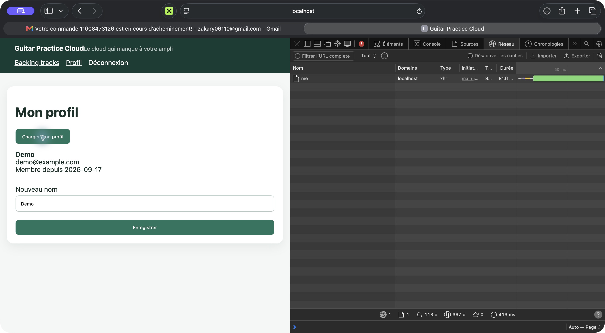

### Où s’effectue la mise à jour du profil ?

1. `frontend-starter/src/app/components/profile-page/profile-page.html` lie le champ du nom au formulaire réactif et appelle `save()` lors de la soumission. Le bouton « Charger mon profil » appelle `load()` : le chargement API n’est pas automatique à l’entrée de la page dans le code actuel.
2. Dans `profile-page.ts`, `load()` appelle `AuthService.profile()` puis remplit le formulaire. `save()` lit `form.getRawValue().name` et appelle `AuthService.update(name)`, le composant n’appelle pas directement `HttpClient`.
3. Dans `src/app/shared/services/auth.service.ts`, `profile()` fait un `GET /api/users/me`, `update(name)` fait un `PUT /api/users/me` avec `{ name }`. Les deux mettent `currentUser` à jour avec `tap(...)` à réception de la réponse.
4. `src/app/shared/interceptors/auth.interceptor.ts` ajoute le Bearer. Dans `backend/src/app.js`, le middleware `auth` vérifie le JWT et place l’identité dans `req.auth.sub`.
5. La route `PUT /api/users/me` utilise `User.findByIdAndUpdate(req.auth.sub, { $set: { name: req.body?.name } }, { new: true, runValidators: true })`. L’utilisateur modifié est celui du JWT, pas un identifiant choisi par le navigateur.
6. `backend/src/models/User.js` définit le champ `name` : obligatoire, espaces aux extrémités supprimés et longueur minimale de deux caractères. Mongoose applique la modification dans MongoDB et le serveur répond avec `user.toPublic()`. Le Signal actualise alors le profil affiché.

La déconnexion, dans `AuthService.logout()`, supprime `gpc_token` et remet `token` et `currentUser` à `null`. Après un 401, l’intercepteur appelle également cette méthode puis redirige vers `/login`.

### Quelle différence entre Signal et localStorage ?

| Aspect | Signal Angular | `localStorage` |
|---|---|---|
| Rôle dans le projet | État réactif courant : `token` et `currentUser` | Conservation du JWT sous la clé `gpc_token` |
| Réactivité | Sa modification avec `.set()` met à jour les vues qui le lisent | Une écriture ne met pas automatiquement à jour un Signal ou le template |
| Durée de vie | État en mémoire de l’application, recréé au rechargement | Persiste entre rechargements jusqu’à suppression |
| Type de données | Peut contenir un objet `User`, une chaîne ou `null` | Stocke des chaînes |

Au démarrage du service, `token` est initialisé depuis `localStorage.getItem('gpc_token')`, mais `currentUser` démarre à `null`. Il faut donc une réponse d’authentification ou un appel au profil pour récupérer les données utilisateur. Lors du login, `storeAuthentication()` met à jour les deux mécanismes. La persistance du JWT ne garantit pas sa validité : il peut avoir expiré côté serveur. Son stockage navigateur reste sensible aux scripts de la page, on ne l’affiche jamais dans les captures ou les logs.

### Questions sur l’assistant IA

**Quel modèle ai-je utilisé ?** J’ai utilisé GPT-6.1 Sol. Pour identifier un modèle, je relève le nom affiché dans l’outil au moment de la séance, le code Angular ne permet pas de le retrouver.

**Comment connaître le nombre de tokens consommés ?** Pour un appel à l’API OpenAI, le champ `usage` de la réponse indique la consommation, notamment `total_tokens`, le tableau de bord d’usage API permet le suivi du compte. Cette méthode est documentée dans la [documentation officielle OpenAI sur l’usage](https://developers.openai.com/api/docs/guides/advanced-usage). Dans une application d’assistance, il faut consulter le suivi d’usage disponible dans l’outil : un quota ou un pourcentage de contexte n’est pas nécessairement un compteur exact des tokens consommés. Je n’ai pas conservé de relevé chiffré des séances de TP et ne peux donc pas annoncer un total vérifié.

### Vérification des requêtes HTTP

J’ai vérifié les requêtes de connexion et de profil dans Network. Les captures suivantes présentent les méthodes, les URL, les statuts et les réponses obtenues.

Le tableau suivant décrit les résultats **attendus d’après le code**. Ils ont ensuite été comparés aux échanges réels consignés ci-dessous.

| Scénario à capturer | Méthode et URL | Corps de requête expurgé | Statut et réponse attendus | Authorization |
|---|---|---|---|---|
| Connexion réussie, après déconnexion | `POST /api/auth/login` | `{ "email": "demo@example.com", "password": "[MASQUÉ]" }` | 200, `{ "token": "[MASQUÉ]", "user": { … } }` | Absent si la session a été nettoyée |
| Connexion refusée, sans session | `POST /api/auth/login` | Même structure, mot de passe incorrect et masqué | 401, `{ "message": "Identifiants incorrects" }` | Absent si aucun token n’est stocké |
| Lecture du profil après reconnexion | `GET /api/users/me` | Aucun | 200, `id`, `name`, `email`, `createdAt` | `Bearer [MASQUÉ]` |
| Modification du profil | `PUT /api/users/me` | `{ "name": "Demo TP1" }` | 200, profil avec le nouveau nom | `Bearer [MASQUÉ]` |
| Token invalide sur le profil | `GET /api/users/me` | Aucun | 401, `{ "message": "Jeton invalide ou expiré" }`, puis retour `/login` | Présent, valeur masquée |

**Procédure de collecte.** Démarrer backend et frontend dans deux terminaux (`npm start` dans chaque dossier, après installation des dépendances). Dans les DevTools, ouvrir Network, activer la conservation du journal et filtrer Fetch/XHR. Se déconnecter, effectuer un login réussi, se déconnecter puis tenter un login refusé. Se reconnecter, aller sur Profil et cliquer « Charger mon profil ». Modifier le nom, enregistrer puis recharger le profil pour vérifier la persistance, restaurer ensuite le nom initial. Pour chaque requête, relever les en-têtes généraux et la réponse, et le corps lorsque présent. Le checkpoint minimal demande une lecture **ou** une modification du profil, capturer les deux documente également la modification du nom.

Pour la preuve 401 d’un token invalide, modifier le token stocké puis recharger l’application pour que le Signal relise le stockage avant de demander le profil. Une modification du stockage seul ne modifie pas le Signal déjà en mémoire.

Avant d’ajouter les captures au projet, masquer entièrement les mots de passe et les valeurs de JWT, dans le corps de requête, la réponse de login et les headers. Ne pas exporter de HAR brut contenant les secrets. Conserver lisibles méthode, URL, statut, noms de champs et présence du Bearer.

#### Résultats de mes vérifications

J’ai vérifié la connexion, le profil et le traitement des réponses 401. Le frontend Angular et l’API Express réels ont été utilisés avec MongoDB Atlas. Un relais HTTP local temporaire sur `127.0.0.1:4201` transmettait les pages à Angular sur 4200 et les requêtes `/api` à Express sur 3000. Le script [scripts/tp1-proof-proxy.mjs](scripts/tp1-proof-proxy.mjs) enregistrait uniquement une version expurgée des échanges. Aucun mock de réponse n’a été utilisé. Les mots de passe et JWT ont été remplacés par `[MASQUÉ]` avant toute écriture sur disque.

| Vérification | Résultat réellement observé |
|---|---|
| Login réussi après ouverture d’une session navigateur sur le port du relais | POST `/api/auth/login`, sans Authorization, JSON email/password, réponse 200 avec token masqué et profil, navigation vers `/tracks` |
| Login refusé après déconnexion | POST identique avec mot de passe incorrect, sans Authorization, 401 et `Identifiants incorrects`, message visible dans la page |
| Lecture du profil après reconnexion | GET `/api/users/me`, sans corps, Bearer présent, réponse 200 avec le profil Demo |
| Modification du nom | PUT `/api/users/me`, Bearer présent, corps `{ "name": "Demo TP1" }`, réponse 200 et nom affiché mis à jour |
| Persistance | Rechargement complet de la page, puis nouveau GET du profil : réponse 200 avec `Demo TP1` |
| Restauration du compte | PUT avec `{ "name": "Demo" }`, réponse 200 et nom initial réaffiché |
| JWT invalide | Pour ce seul GET profil, le relais a remplacé le Bearer par un jeton invalide avant l’envoi à l’API. Express a réellement répondu 401 `Jeton invalide ou expiré`, l’intercepteur Angular a nettoyé la session et redirigé vers `/login` |

J’ai testé le rejet d’un JWT invalide en remplaçant le jeton dans le relais local. Après vérification de la redirection, j’ai reconnecté le compte sur `http://127.0.0.1:4200/tracks` et arrêté le relais.

**Preuve HTTP détaillée.** [Journal JSON des requêtes et réponses réelles, expurgé](captures/tp1-requetes-reelles.json). Chaque entrée indique méthode, URL, corps, statut, type de contenu et présence d’Authorization. Les heures du JSON sont en UTC. La capture ci-dessous montre sa présentation lisible, produite par le relais.

**Lecture du journal HTTP.** J’ai regroupé les échanges de connexion et de profil dans ce journal. Pour chaque requête, je peux lire la méthode, l’URL, le statut et le corps expurgé. Les valeurs sensibles sont remplacées par `[MASQUÉ]`.

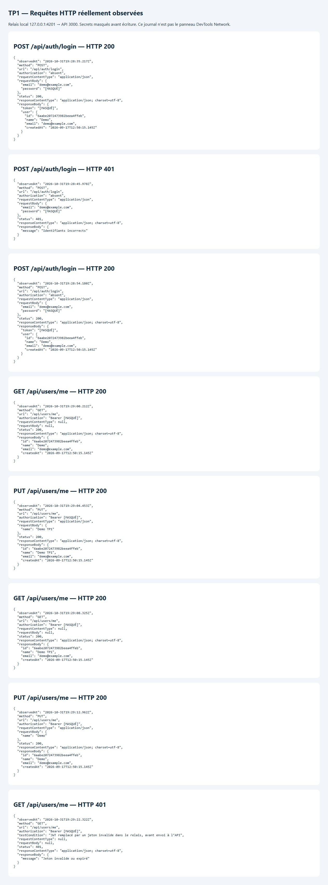

**Captures de l’interface réelle.**

J’ai testé la connexion, le refus des mauvais identifiants, la lecture du profil, la modification du nom et le retour à la connexion après un JWT invalide. Les captures suivantes montrent les résultats dans l’application.

**1. Connexion réussie.** J’ai utilisé le compte de démonstration et cliqué sur « Se connecter ». Après acceptation des identifiants par l’API, l’application m’a redirigé vers la bibliothèque. La capture montre cette page accessible et la navigation d’un utilisateur connecté, avec les liens Profil et Déconnexion.

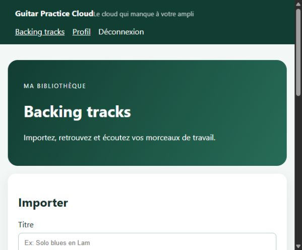

**2. Connexion refusée.** Après déconnexion, j’ai essayé de me connecter avec un mauvais mot de passe. Je reste sur la page Connexion et le message « Identifiants incorrects » apparaît sous le formulaire. La réponse HTTP associée est un 401. Le mot de passe reste masqué dans le champ.

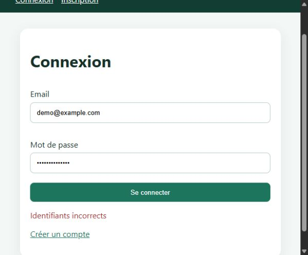

**3. Lecture du profil.** Après reconnexion, j’ai ouvert Profil et cliqué sur « Charger mon profil ». L’application a demandé les informations du compte avec `GET /api/users/me`. La capture montre le nom « Demo », l’adresse du compte de démonstration et la date d’inscription retournés par l’API. Le champ « Nouveau nom » est également rempli avec le nom actuel.

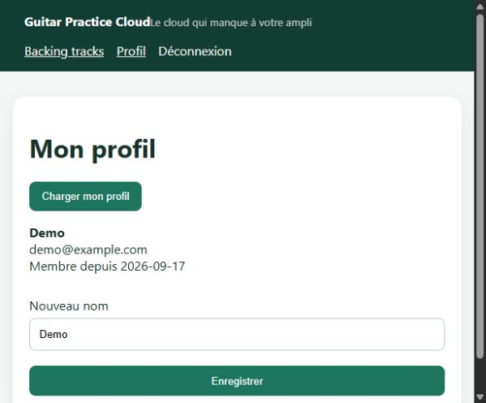

**4. Modification du nom et persistance.** J’ai remplacé « Demo » par « Demo TP1 », puis cliqué sur « Enregistrer ». Cette action envoie `PUT /api/users/me` avec le nouveau nom. J’ai ensuite rechargé la page et demandé à nouveau le profil. La capture montre que « Demo TP1 » est toujours présent : la modification a été enregistrée côté serveur, elle ne concerne pas seulement le champ du formulaire. Après ce test, j’ai rétabli le nom « Demo ».

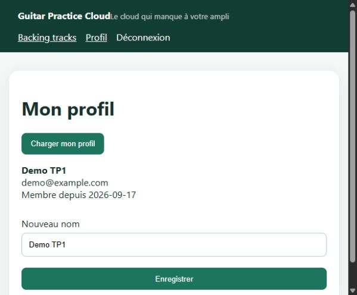

**5. Retour à la connexion après un JWT invalide.** Pour ce test, le relais local a remplacé le JWT d’une requête de profil par un jeton invalide. L’API a répondu 401 et l’intercepteur Angular a effacé la session puis redirigé vers `/login`. La capture montre la page Connexion et les liens Connexion et Inscription à la place de la navigation connectée.

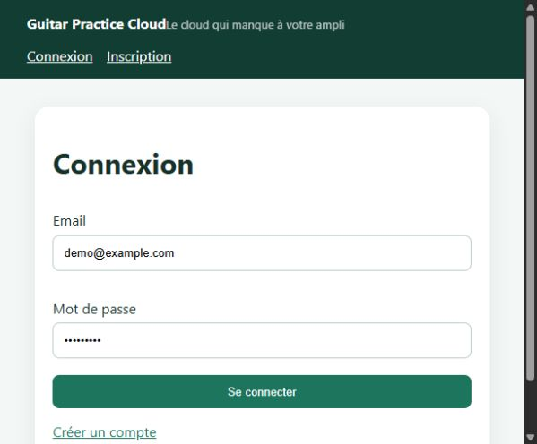

#### Vérifications dans Network

J’ai testé les trois scénarios directement sur `http://127.0.0.1:4200` et consulté les requêtes dans Network. J’ai vérifié la connexion réussie, la connexion refusée et la lecture du profil.

| Scénario | Observation dans mon navigateur | Preuves |
|---|---|---|
| Connexion réussie | Requête `login`, méthode POST, URL `/api/auth/login`, HTTP 200, arrivée dans la bibliothèque | Liste Network et détails Headers ci-dessous |
| Connexion refusée après déconnexion | POST `/api/auth/login`, HTTP 401, message `Identifiants incorrects` dans la réponse JSON et dans l’interface | Headers et Response ci-dessous |
| Lecture du profil après reconnexion | GET `/api/users/me`, HTTP 200, réponse avec `id`, `name`, `email`, `createdAt`, sans mot de passe ni JWT | Headers et Response ci-dessous |

J’ai masqué les informations sensibles et conservé les méthodes, les URL et les statuts lisibles. Le test volontaire avec un mauvais mot de passe produit une erreur 401 attendue.

**Connexion réussie dans Network.** J’ai envoyé le formulaire de connexion. La ligne `login` affiche 200, puis une requête de bibliothèque apparaît après la redirection. Je constate ainsi que l’authentification acceptée est suivie du chargement des pistes.

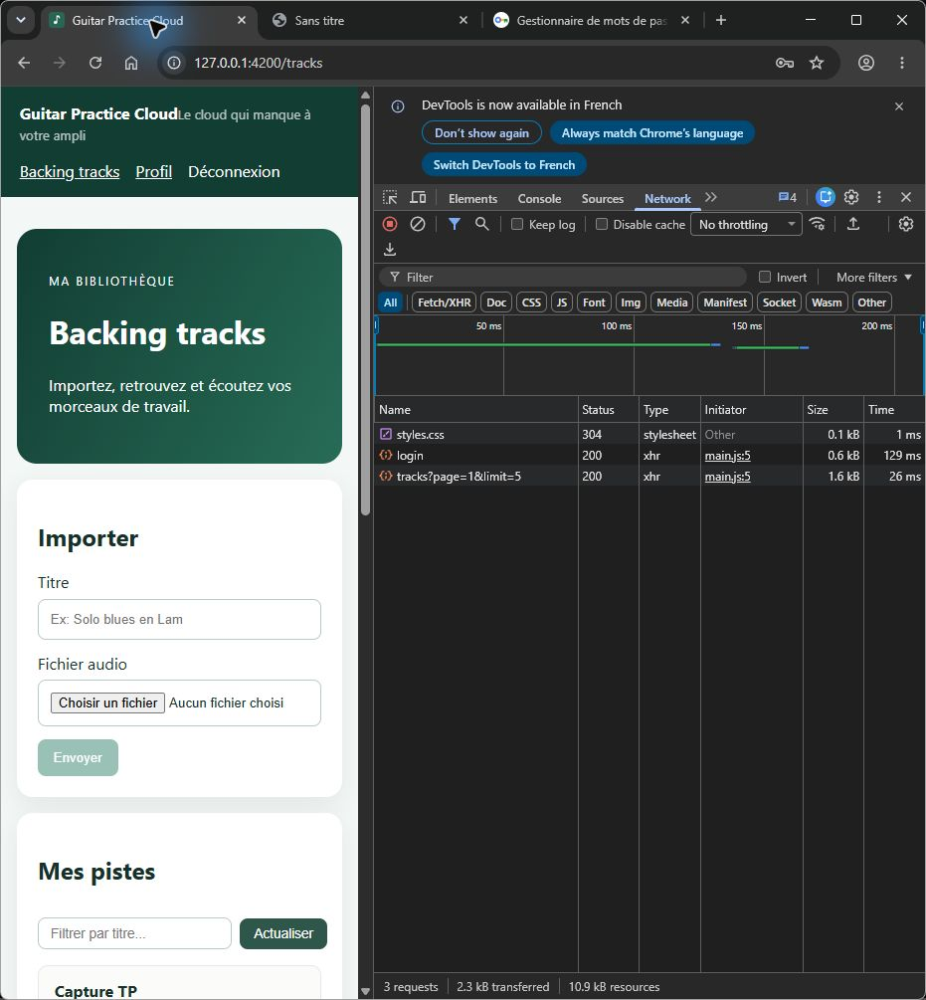

**Détails du login accepté.** J’ai sélectionné la requête `login`, puis ouvert Headers. Je peux lire l’URL `/api/auth/login`, la méthode POST et le statut 200 OK. Je laisse le corps contenant le mot de passe et la réponse contenant le JWT hors de cette capture.

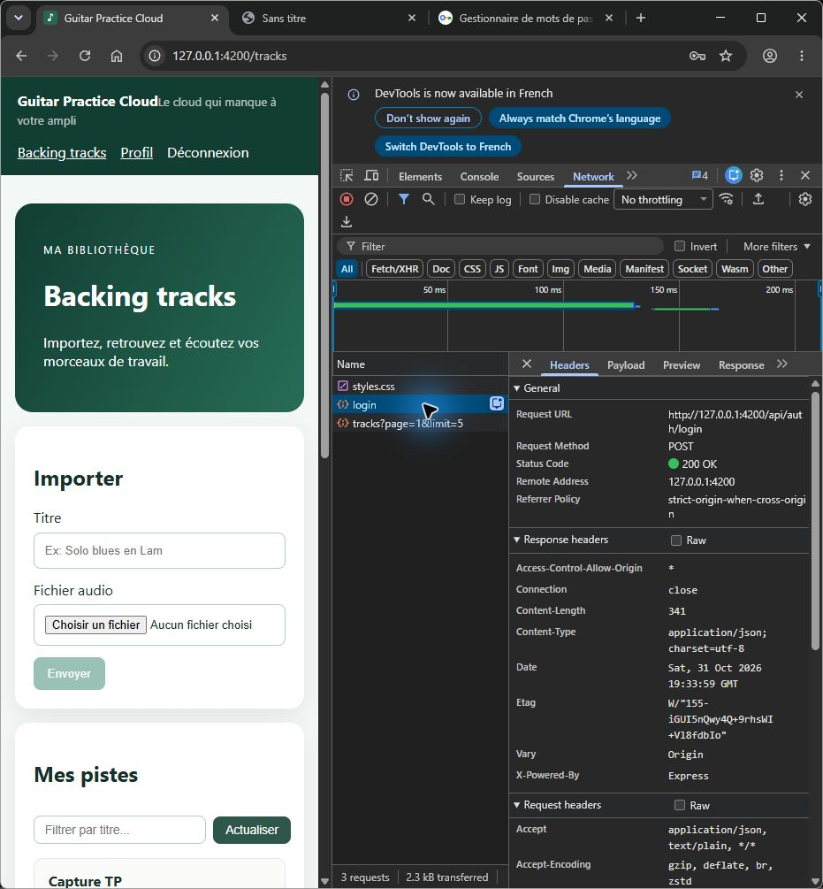

**Détails du login refusé.** J’ai soumis un mauvais mot de passe après déconnexion. Dans Headers, je retrouve le même POST de connexion avec le statut 401 Unauthorized. Le formulaire reste affiché avec le message d’erreur, ce qui montre le résultat côté interface et côté HTTP.


**Réponse du serveur après le refus.** J’ai ouvert Response sur cette requête en échec. Le JSON contient `Identifiants incorrects`, le même message que dans le formulaire. Je vérifie ainsi que l’interface reprend le message renvoyé par l’API.

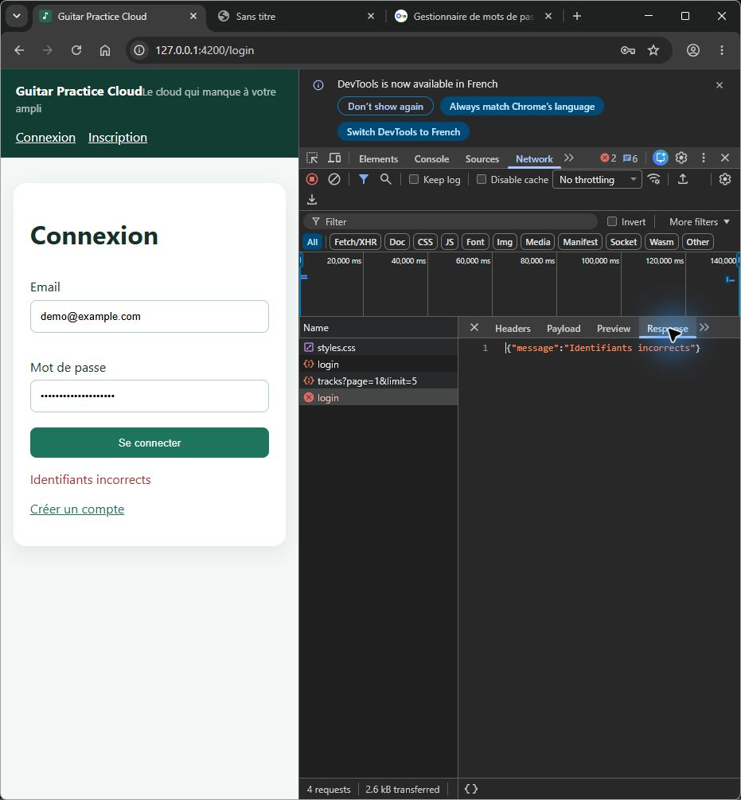

**Requête de lecture du profil.** J’ai cliqué sur Charger mon profil et sélectionné la requête `me`. Headers affiche GET `/api/users/me` et 200 OK. Le profil est visible à gauche, la valeur du JWT n’apparaît pas dans la zone capturée.

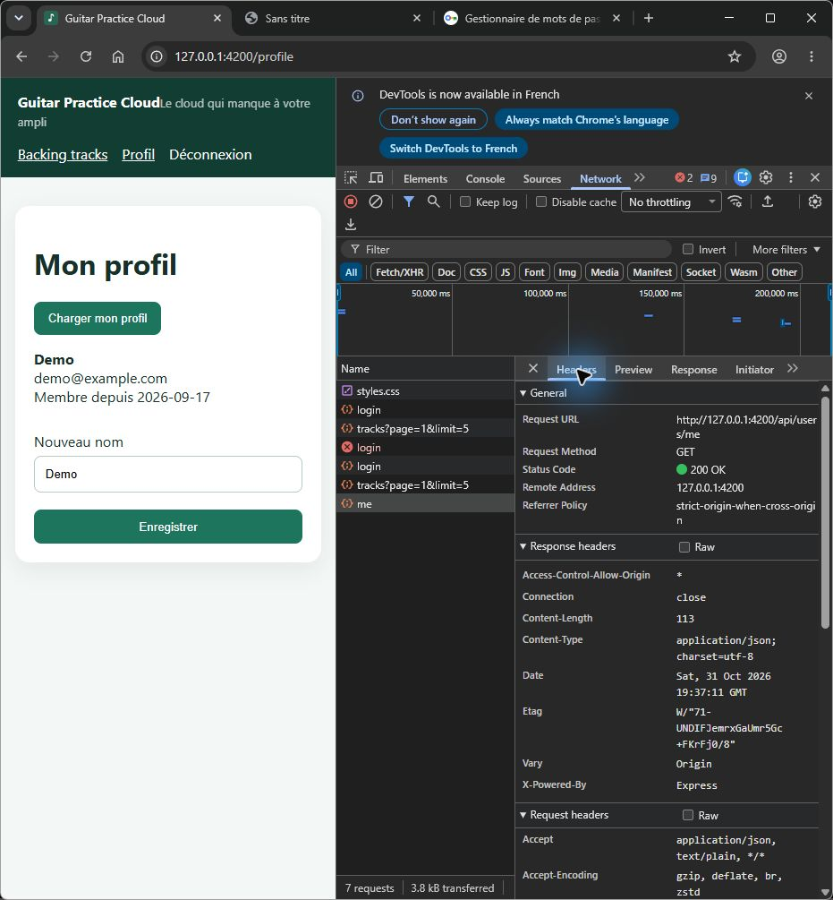

**Données du profil reçues.** J’ai ouvert Response sur le GET du profil. Je retrouve les champs publics `id`, `name`, `email` et `createdAt`. Ils correspondent aux informations affichées dans la page et la réponse ne contient ni mot de passe ni JWT.

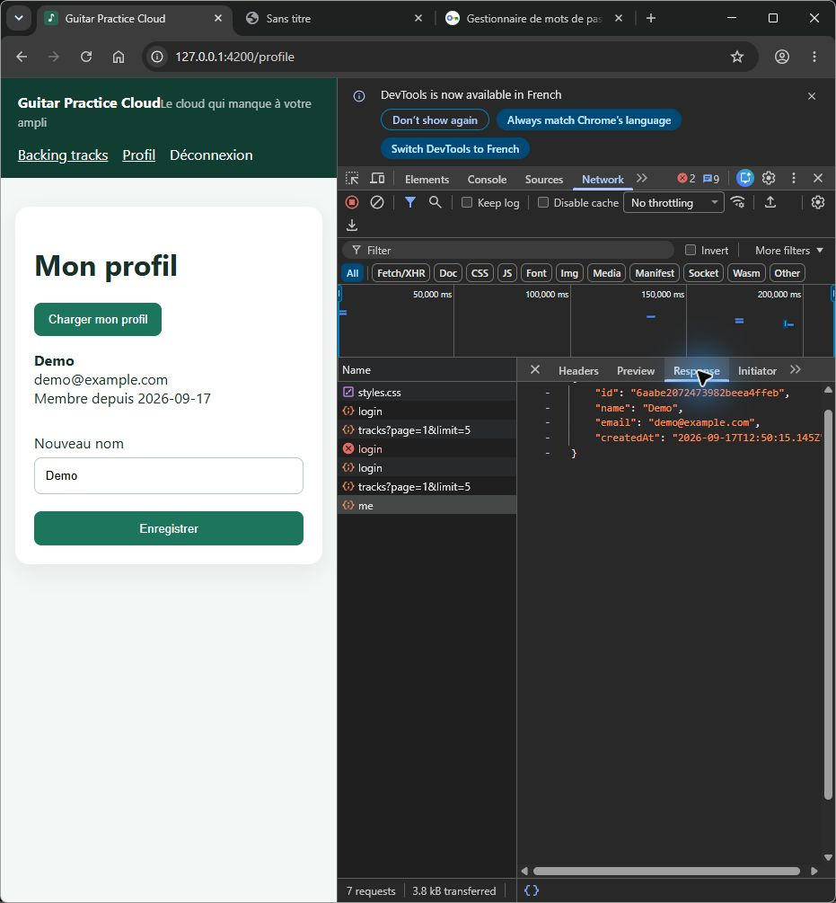

## Mission 2 : Bibliothèque paginée (TP2)

**Objectif.** Afficher les pistes page par page à partir de `GET /api/tracks`, avec les paramètres `page` et `limit`.

**Ce que j’ai demandé à l’IA.** Je lui ai demandé une pagination côté serveur avec des boutons désactivés aux limites de la liste.

**Exemple de prompt :**

> « Vérifie que la bibliothèque appelle GET /api/tracks?page=1&limit=5 et désactive les boutons aux extrémités. »

**Ce que j’ai obtenu.** Le service et le composant utilisent la pagination côté serveur. `TrackService.list(page, limit)` transmet les paramètres au backend. Le composant conserve les pistes, la page courante, le nombre de pages et l’état de chargement dans des Signals. `load()` récupère la page demandée, `go(page)` change de page puis relance le chargement. Le template gère la liste vide et désactive « Préc. » sur la première page et « Suiv. » sur la dernière.

**Mon choix.** J’ai conservé la pagination côté serveur, conformément au sujet. Charger toute la bibliothèque puis utiliser `slice()` aurait contourné cette exigence. Le filtre par titre porte uniquement sur les pistes de la page chargée.

**Comment j’ai vérifié.** J’ai consulté le panneau Network et enregistré les captures. La page 2 sur 2 affiche deux pistes sur un total de sept, avec `page: 2`, `limit: 5`, `total: 7`, `pages: 2`. La requête répond avec le statut 200. Une limite de cinq correspond à un maximum par page : la dernière peut contenir moins d’éléments. J’ai également vérifié un aller-retour entre les pages 1 et 2.

**Fichiers concernés.** `track.service.ts`, `tracks-page.ts` et `tracks-page.html`.

**Affichage de la deuxième page.** J’ai utilisé le bouton Suivant pour passer à la page 2. Je vois deux pistes sur cette dernière page, sur un total de sept dans la réponse JSON. Le bouton Suivant est désactivé à la dernière page. La limite de cinq est un maximum par page, pas un nombre obligatoire de résultats.

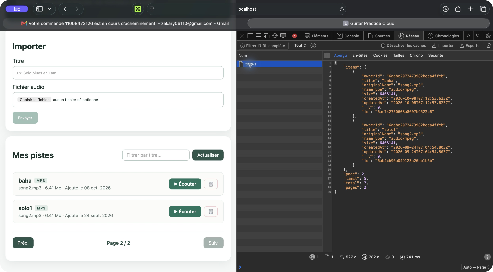

**Pagination envoyée au serveur.** J’ai ouvert les détails de la requête déclenchée par le changement de page. Je retrouve GET `/api/tracks?page=2&limit=5` avec le statut 200. Cette URL confirme que la page et la limite sont transmises à l’API.

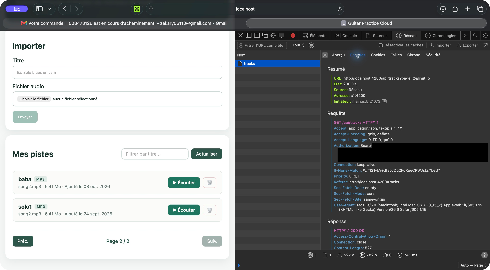

## Mission 3 : Upload, validation et lecture audio (TP2)

### Cartographie précise du flux d’upload et des validations

J’ai identifié les fichiers et méthodes de chaque étape de l’upload et vérifié les refus du serveur. Les routes du backend sont conservées.

| Étape | Fichier et méthode | Rôle |
|---|---|---|
| Choisir le fichier | `frontend-starter/src/app/components/tracks-page/tracks-page.html`, événement `(change)`, `tracks-page.ts`, `choose(event)` | Lit `HTMLInputElement.files[0]` et conserve le `File` dans `file` |
| Valider et déclencher | `tracks-page.ts`, `upload(fileInput)` | Vérifie la taille et le format avant HTTP, bloque les doublons, désactive le titre et appelle le service |
| Construire le multipart | `frontend-starter/src/app/shared/services/track.service.ts`, `upload(file, title)` | Crée `FormData` et ajoute exactement `audio` et `title` |
| Envoyer | Même méthode du service | `HttpClient.post('/api/tracks', body, { observe: 'events', reportProgress: true })`, l’intercepteur ajoute le Bearer |
| Vérifier l’identité | `backend/src/app.js`, middleware `auth` de la route POST | Vérifie le JWT et renseigne `req.auth.sub` |
| Traiter le fichier | `backend/src/app.js`, configuration `upload` et `upload.single('audio')` | Multer extrait un seul fichier du champ `audio`, écrit sur disque avec `diskStorage`, renseigne `req.file` et les champs texte dans `req.body` |
| Vérifier sa présence | Callback de POST `/api/tracks` | `if (!req.file)` renvoie 400 `Fichier audio requis` |
| Enregistrer les métadonnées | Même callback, `Track.create(...)` | Lit `req.body.title` ou prend le nom original, associe `ownerId: req.auth.sub`, format, taille et nom de stockage, renvoie 201 |
| Gérer l’échec | Gestionnaire d’erreur final dans `backend/src/app.js` | Transforme une erreur Multer ou `Format audio non accepté` en réponse JSON 400 |
| Réagir dans l’interface | `tracks-page.ts`, callbacks de `upload()` | Met à jour la progression, affiche les erreurs serveur, seul l’événement `Response` annonce le succès, vide le formulaire et recharge la page 1 |

Dans le backend, `limits: { fileSize: MAX_FILE_SIZE }` impose `25 * 1024 * 1024`, soit **26 214 400 octets (25 Mio)**. Le `fileFilter` vérifie l’appartenance du MIME à l’ensemble `allowed` : `audio/mpeg`, `audio/wav`, `audio/x-wav`, `audio/ogg`, `audio/mp4`, `audio/x-m4a`. Il ne suffit donc pas que le MIME commence par `audio/`. Multer ne réalise pas une analyse complète du contenu sonore : le filtre de MIME ne prouve pas que les octets sont décodables.

J’ai resserré la validation frontend sur ces six types MIME, si le navigateur fournit un type vide, une extension attendue sert de présélection. Une extension audio ne permet plus de contourner un MIME explicitement refusé. Le serveur conserve la décision finale. La limite frontend existante de **25 000 000 octets (25 Mo décimaux)** est conservée : elle est légèrement plus restrictive que celle du serveur, ce qui explique le rejet local du fichier de 26 000 000 octets dans le test de taille. Ce fichier ne prouve pas un dépassement de la limite Multer. Les messages frontend indiquent explicitement le seuil en octets.

Le frontend donne un retour immédiat et évite un transfert inutile. Il ne sécurise pas l’API : un autre client peut ignorer ces contrôles, comme dans le test de refus MIME ci-dessous. La validation serveur reste indispensable.

### Cartographie précise de la lecture authentifiée

Dans `tracks-page.html`, le bouton Écouter appelle `play(track)` de `tracks-page.ts`. Cette méthode appelle `TrackService.audio(track.id)`, dans `track.service.ts`, cette méthode fait `HttpClient.get('/api/tracks/:id/audio', { responseType: 'blob' })`. `auth.interceptor.ts` ajoute `Authorization`. Dans `backend/src/app.js`, `auth` vérifie le JWT et la route audio utilise `Track.findOne({ _id: req.params.id, ownerId: req.auth.sub })`, puis `res.sendFile(audioPath)`.

À la réception du Blob, `play()` révoque la précédente URL avec `URL.revokeObjectURL`, crée la suivante avec `URL.createObjectURL(blob)` et renseigne le Signal `audioUrl`. Le template affecte `[src]="audioUrl()"` au lecteur `<audio>`. `currentTrack`, `audioLoading` et `audioError` pilotent l’affichage. `ngOnDestroy()` révoque la dernière ObjectURL, `removeDeletedTrack()` nettoie aussi le lecteur quand la piste active est supprimée. Le téléchargement HTTP d’un Blob complet, le buffering du lecteur et le transfert progressif depuis le disque sont des étapes différentes, détaillées dans les cinq réponses plus bas.

### Fiabilisation du chargement de la bibliothèque

J’ai ajouté la gestion des erreurs de chargement de la bibliothèque avec l’aide de l’IA. `tracks-page.ts` possède désormais le Signal `listError`. `load()` l’efface au début d’un nouvel essai et lui affecte un message après un échec HTTP. Le template affiche ce message avec `role="alert"`. Le bouton Actualiser permet de relancer la requête, les anciennes pistes ne sont pas effacées en cas d’échec. L’état vide n’est plus affiché pendant le premier chargement ni à la place d’une erreur. Un test HTTP simulé vérifie le message après 503, la fin du chargement, la conservation des pistes et la disparition de l’erreur après un nouvel essai réussi.

Après ces changements et le test du refus local de FLAC : **9 tests frontend sur 9 réussis**, **2 tests backend sur 2 réussis**, et build Angular réussi en 4,063 s sous Node 24.21.0. J’ai ajouté deux tests pour la gestion des erreurs de bibliothèque et la validation du format. Le frontend a également été rechargé dans mon navigateur et la connexion suivie du GET de bibliothèque a été vérifiée : liste affichée, requête avec `page=1&limit=5` (304 avec réutilisation du cache navigateur). Les détails des dernières commandes sont dans [RAPPORT_TESTS_TP3.md](RAPPORT_TESTS_TP3.md).

### Preuves réelles du refus d’upload et des droits audio

J’ai effectué les contrôles avec un client de vérification séparé, [scripts/tp2-proof-server.mjs](scripts/tp2-proof-server.mjs), sur `127.0.0.1:4202`. Ce client transmet les appels `/api` à la véritable API Express sur 3000 et utilise MongoDB Atlas, il ne simule aucune réponse. Il contourne volontairement la validation Angular pour tester celle du serveur. J’ai également vérifié l’affichage des erreurs d’upload dans les tests du composant Angular.

| Contrôle réel | Résultat |
|---|---|
| Upload multipart valide de la piste temporaire de preuve | POST `/api/tracks`, champs `audio` et `title`, réponse 201 |
| Upload volontaire d’un fichier texte `tp2-invalide.txt`, MIME `text/plain` | POST `/api/tracks`, réponse **400**, JSON `Format audio non accepté` |
| Audio de la piste temporaire avec le JWT du propriétaire | GET audio, réponse **200**, `audio/mpeg`, 3 605 337 octets |
| Identité du second utilisateur | GET `/api/users/me`, réponse 200 avec un identifiant différent du propriétaire |
| Même identifiant de piste et même URL audio, avec le JWT du second compte | Réponse **404**, JSON `Piste inconnue` |
| Nettoyage | Piste temporaire supprimée par l’API, compte temporaire supprimé, anciennes pistes conservées |

Le backend renvoie volontairement 404 pour une piste absente **ou** appartenant à un autre utilisateur. Le 200 obtenu juste avant avec le propriétaire prouve ici que la piste existait bien et que son fichier était disponible. La sécurité repose sur la condition `ownerId` dans la requête serveur, pas sur le guard Angular.

Les observations expurgées sont dans [captures/tp2-verifications-reelles.json](captures/tp2-verifications-reelles.json). Les valeurs des JWT et des mots de passe ne sont pas conservées dans ce fichier ni affichées dans les captures. Les lignes de login et de session du client restent repliées dans Network.

**Comparaison des réponses de l’API.** J’ai lancé les contrôles avec un client de vérification séparé d’Angular. Network montre l’upload valide en 201, l’upload invalide en 400, puis deux lectures de la même piste en 200 et 404 selon le compte utilisé. Le journal expurgé précise l’identité utilisée pour chaque lecture.

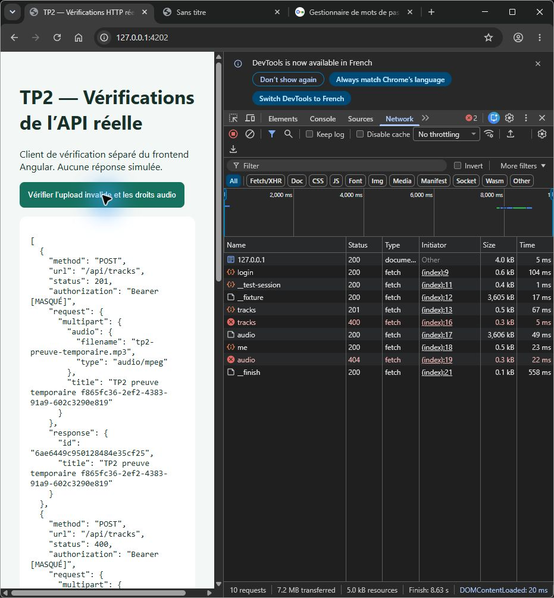

**Contenu de l’envoi volontairement invalide.** J’ai sélectionné le POST refusé et ouvert Payload. Je retrouve les deux champs multipart `audio` et `title`. Le fichier texte a été envoyé volontairement par le client de vérification pour tester le serveur sans passer par le blocage préalable d’Angular.

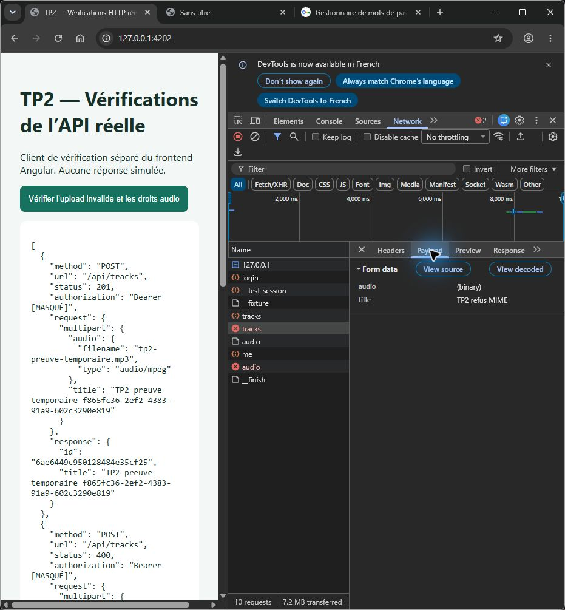

**Erreur de format renvoyée par le serveur.** J’ai ouvert Response sur le POST invalide. Le JSON affiche `Format audio non accepté`. Cette réponse, associée au 400 de la liste Network, confirme que le backend refuse le MIME du fichier texte.

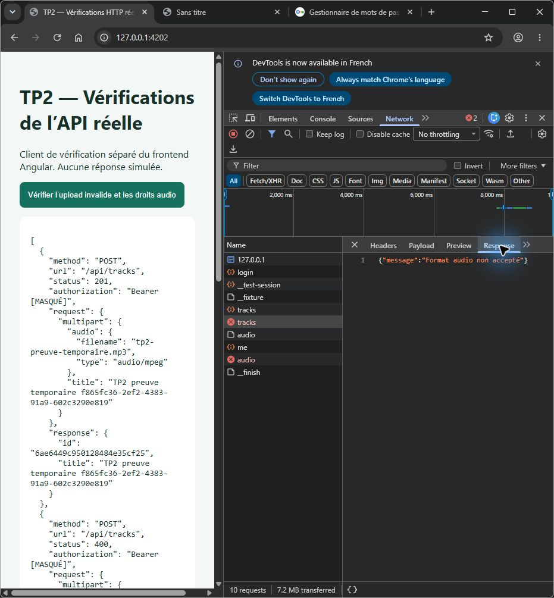

**Lecture refusée à un autre compte.** J’ai sélectionné la seconde requête audio, envoyée avec le JWT du compte temporaire. Le serveur répond `Piste inconnue`. La comparaison avec la lecture 200 du propriétaire, sur la même piste avant nettoyage, permet de distinguer ce refus d’un simple fichier absent.

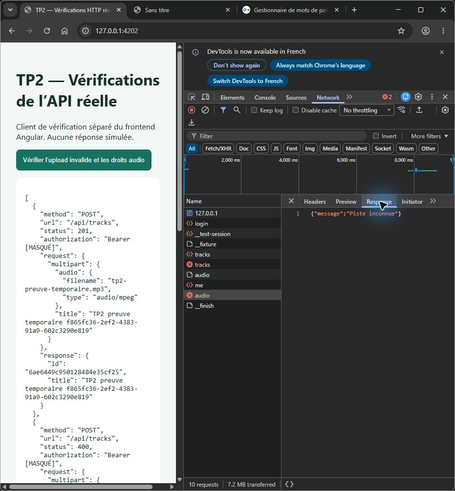

**Fichiers audio locaux.** J’ai constaté que certaines anciennes pistes sont présentes dans Atlas sans fichier correspondant dans `backend/data/uploads`. Pour vérifier la lecture et les droits, j’ai envoyé un MP3 temporaire. J’ai obtenu 200 avec le propriétaire et 404 avec un autre compte. J’ai ensuite supprimé la piste et le compte temporaires. Les anciens morceaux nécessitent une restauration de leurs fichiers ou un nouvel upload pour être lus sur cette machine.

### Validation et envoi d’un fichier : réalisation initiale

**Objectif.** Vérifier le fichier avant l’envoi et informer l’utilisateur pendant le traitement.

**Ce que j’ai demandé à l’IA.** Je lui ai demandé de compléter la validation du fichier et les messages affichés pendant l’envoi.

**Exemple de prompt :**

> « Bloque l’envoi si le fichier dépasse 25 Mo ou n’est pas audio. Affiche le chargement, les erreurs et un message de succès. »

**Ce que j’ai obtenu.** Avec l’aide de l’IA, j’ai complété la méthode `upload()` pour vérifier la taille du fichier ainsi que son type MIME ou son extension. Si le fichier est invalide, elle renseigne `uploadError` et quitte la méthode avant l’appel HTTP. Les Signals `uploading`, `uploadError` et `uploadSuccess` pilotent les contrôles et les messages. Après un succès, le titre, le fichier sélectionné et l’élément HTML de sélection sont réinitialisés, la page 1 est rechargée. Cette gestion a ensuite été enrichie par la progression de la mission 6.

**Corrections et choix retenus.** J’ai conservé les contrôles du serveur : la validation du navigateur améliore le retour utilisateur, mais ne suffit pas à sécuriser l’upload. Le backend conserve les limites et la validation Multer. Vider uniquement la variable TypeScript du fichier ne suffit pas : il faut aussi réinitialiser l’élément `<input type="file">`.

**Comment j’ai vérifié.** J’ai contrôlé le rejet local : un fichier synthétique de 26 000 000 octets, nommé avec l’extension `.mp3`, est refusé sans requête réseau. Il sert uniquement au contrôle de taille et n’a pas été envoyé au serveur. Un envoi réel de `song1.mp3` a ensuite permis de vérifier les champs multipart `audio` et `title`, ainsi que l’ajout de la piste. La réponse 201 et le formulaire vidé sont également visibles dans les preuves de la mission 6. La gestion d’une erreur serveur et d’un nouvel essai est couverte par les tests de la mission 7.

**Fichiers concernés.** `tracks-page.ts`, `tracks-page.html` et `tracks-page.css`.

**Blocage local d’un fichier trop volumineux.** J’ai sélectionné un fichier synthétique de 26 000 000 octets. Le message indique le dépassement du seuil frontend de 25 000 000 octets et aucune requête d’upload n’est envoyée. Le blocage intervient avant l’appel HTTP.

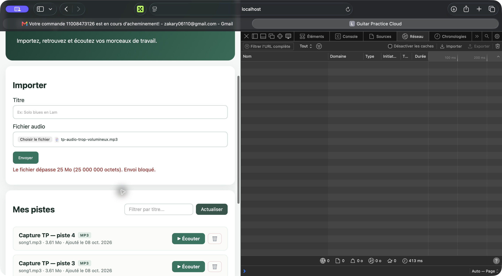

**Structure de l’upload réel.** J’ai envoyé un fichier audio et ouvert le détail de la requête dans Network. Le multipart contient le fichier sous le nom `audio` et le titre sous le nom `title`. Je vérifie ainsi que le service respecte les noms attendus par le backend.

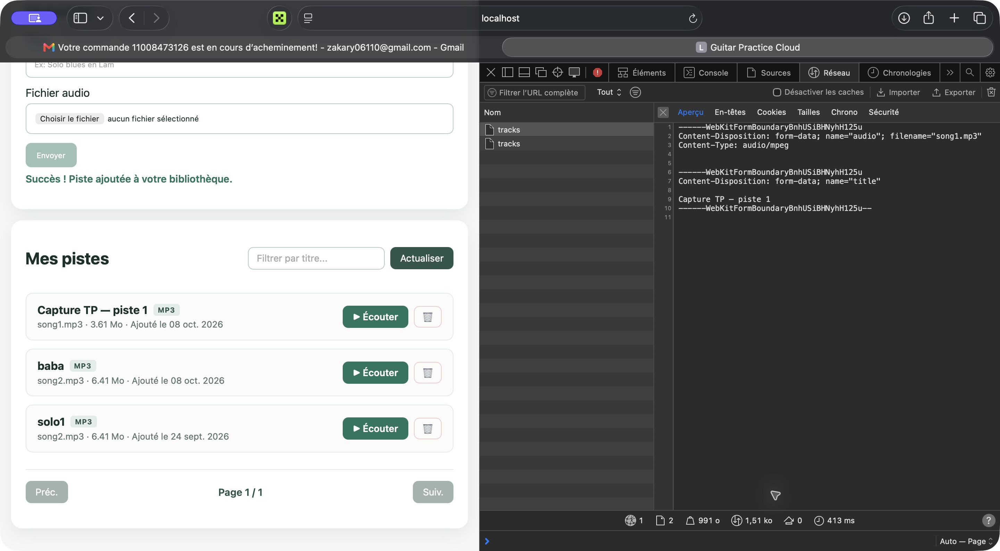

### Lecture authentifiée et gestion de l’ObjectURL

**Objectif.** Afficher le morceau en cours, signaler les erreurs de lecture et libérer l’URL du fichier lorsque le lecteur n’en a plus besoin.

**Ce que j’ai demandé à l’IA.** Je lui ai demandé de compléter le lecteur et de m’expliquer la gestion du fichier audio.

**Exemple de prompt :**

> « Ajoute le nettoyage de l’ObjectURL dans ngOnDestroy et affiche clairement le morceau en cours de lecture. »

**Ce que j’ai obtenu.** J’ai complété le lecteur avec l’IA. `TrackService.audio(id)` récupère le fichier avec `HttpClient` et `responseType: 'blob'`. L’intercepteur ajoute l’en-tête d’authentification. Le composant crée ensuite une URL locale avec `URL.createObjectURL(blob)` et la transmet au lecteur. Les Signals `currentTrack`, `audioLoading` et `audioError` servent à afficher la piste active, le chargement et les erreurs. L’ancienne ObjectURL est révoquée au changement de piste, à la suppression de la piste active et à la destruction du composant.

**Mon choix.** J’ai conservé le passage par `HttpClient`, car une URL HTTP placée directement dans `<audio src>` ne passe pas par l’intercepteur Angular et ne reçoit donc pas son en-tête Bearer. J’ai écarté l’ajout du JWT dans l’URL, car il pourrait apparaître dans l’historique et les journaux. L’en-tête `Authorization` transporte le jeton, le chiffrement du transport dépend de HTTPS, et non de la présence de cet en-tête.

**Comment j’ai vérifié.** J’ai vérifié la lecture de « Capture TP - piste 4 ». La requête répond avec le statut 200 et `Content-Type: audio/mpeg`. Après navigation vers Profil, la console affiche le message de révocation dans `ngOnDestroy`. Ce message confirme l’exécution du nettoyage, il ne mesure pas la mémoire libérée.

**Fichiers concernés.** `track.service.ts`, `tracks-page.ts`, `tracks-page.html` et `tracks-page.css`.

**Lecture audio authentifiée.** J’ai lancé la lecture d’une piste. Le lecteur est en cours de lecture et Network montre la requête audio avec un Bearer masqué, une réponse 200 et le type `audio/mpeg`. Je constate que le fichier a été récupéré par une requête authentifiée avant son utilisation par le lecteur.

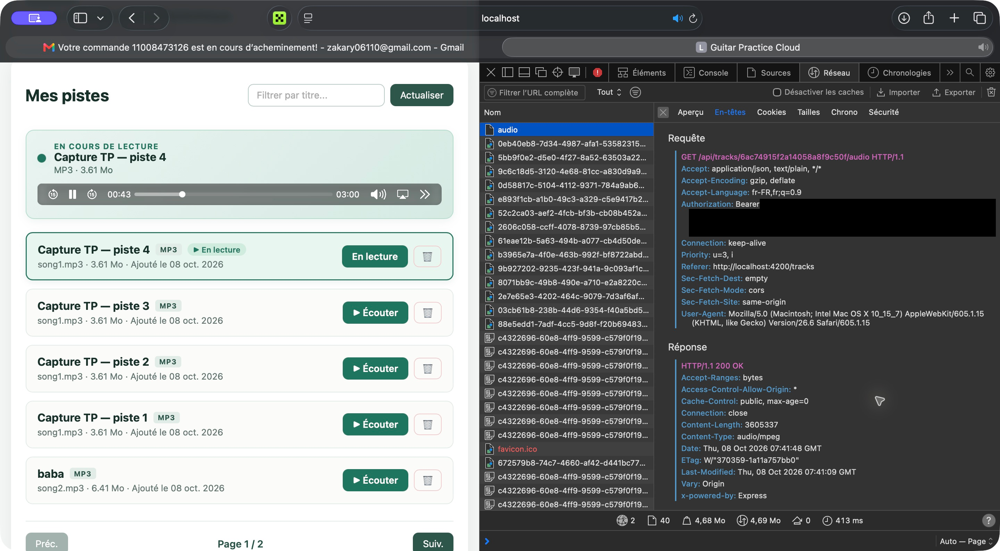

**Nettoyage du lecteur en quittant la bibliothèque.** J’ai navigué vers Profil après avoir chargé un morceau. La console affiche le message de révocation de l’ObjectURL dans `ngOnDestroy`. Je vérifie que le nettoyage est exécuté, ce message ne mesure pas directement la mémoire libérée.

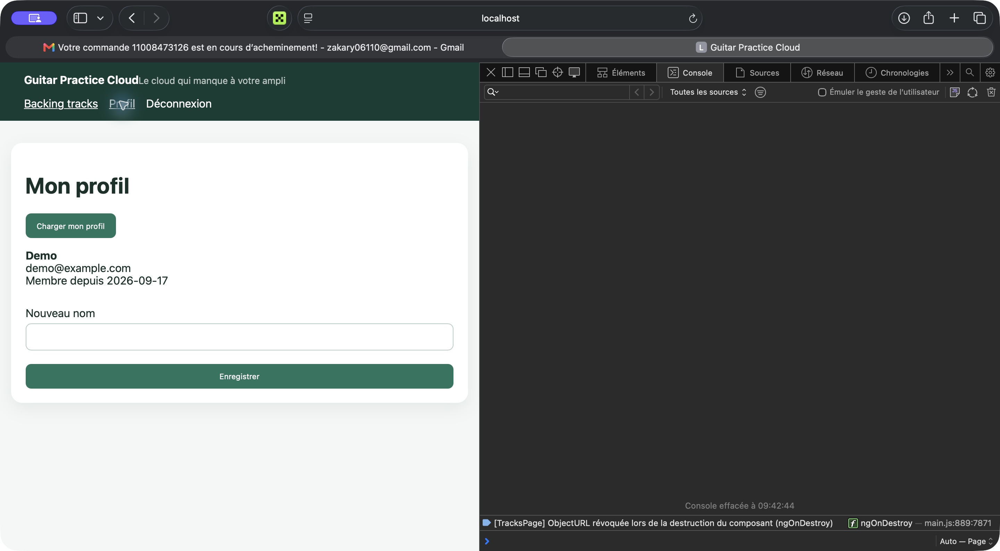

### Réponses aux questions sur la mémoire, le buffering et le streaming

#### 1. Le backend charge-t-il le fichier entier en mémoire ?

La route audio de `backend/src/app.js` utilise `res.sendFile(audioPath)` après vérification du JWT et du propriétaire. Le fichier peut être transféré progressivement depuis le disque. Le code de la route ne crée pas un Buffer contenant tout le fichier avant de répondre. Cela ne signifie pas que la consommation mémoire est nulle : le transfert utilise des tampons et dépend aussi du nombre de requêtes simultanées.

#### 2. Quand le composant reçoit-il le Blob ?

Dans l’appel actuel, `HttpClient` émet le Blob une fois la réponse entièrement téléchargée. Le composant crée alors l’ObjectURL et lance la lecture. Le serveur peut envoyer les octets progressivement, mais cette implémentation du composant attend le fichier complet avant de le transmettre au lecteur.

#### 3. Cent pistes dans la bibliothèque impliquent-elles cent fichiers audio chargés ?

Non. `TrackService.list()` demande uniquement les métadonnées de la page courante. Les fichiers binaires sont récupérés par une route distincte, appelée dans `play(track)` après une action de lecture. Le nombre de fichiers audio téléchargés ne dépend donc pas directement du nombre de pistes enregistrées dans la bibliothèque.

#### 4. Que changerait l’utilisation de cent éléments `<audio>` avec une URL HTTP ?

Le navigateur gérerait directement le chargement des médias. Selon `preload`, ses choix et les possibilités du serveur, il pourrait charger des métadonnées ou une partie des fichiers avant la lecture. Cela peut augmenter le nombre de requêtes et les ressources utilisées, cela ne permet pas de conclure que cent téléchargements complets seraient lancés simultanément. La lecture directe peut commencer avant la réception de tout le fichier. Avec l’API actuelle, elle poserait aussi un problème d’authentification, puisque ces éléments n’ajoutent pas l’en-tête Bearer de l’intercepteur Angular.

#### 5. Pourquoi révoquer l’ObjectURL ?

Une ObjectURL maintient une référence vers le Blob associé. La révoquer lorsqu’elle n’est plus utilisée permet au navigateur de libérer les ressources correspondantes lorsque les autres références ont disparu. Cette libération n’est pas nécessairement immédiate et le stockage du Blob n’est pas forcément limité à la RAM. Le composant effectue ce nettoyage au changement de piste et dans `ngOnDestroy`.

Le flux de lecture est le suivant :

```text
Clic sur Écouter
  → TracksPage.play(track)
  → TrackService.audio(id)
  → HttpClient + intercepteur Authorization
  → vérification du JWT et du propriétaire par le backend
  → transfert du fichier par res.sendFile
  → réception du Blob complet
  → création d’une ObjectURL
  → lecture par <audio>
  → révocation de l’ObjectURL lorsqu’elle n’est plus utilisée
```

### Améliorations facultatives réalisées (TP2)

La bibliothèque comprend aussi la suppression avec confirmation, le formatage des tailles et des dates, un filtre local et la mise en évidence de la piste active. La suppression a été complétée dans la mission 5 du TP3.

## Mission 5 : Suppression d’une piste (TP3)

**Objectif.** Compléter la suppression existante avec un état de requête, un SnackBar et la gestion d’une liste devenue obsolète.

**Ce que j’ai demandé à l’IA.** Les boutons, la confirmation et l’appel au service existaient déjà. Je lui ai demandé de compléter les états et les messages.

**Exemple de prompt :**

> « Ajoute un état de suppression pour empêcher les doubles clics, puis un SnackBar après succès ou erreur. »

**Ce que j’ai obtenu.** J’ai complété la suppression avec l’aide de l’IA. Le Signal `deleting` contient l’identifiant de la piste en cours de suppression. Les boutons sont désactivés pendant la requête et la méthode refuse un second appel. La confirmation native et l’appel à `TrackService.delete(id)` sont conservés. `finalize` remet l’état à zéro après succès ou erreur. Un SnackBar indique le résultat, après une réponse 404 ou 403, un message signale que la piste est supprimée ou inaccessible et la liste est actualisée. Le lecteur est nettoyé si la piste supprimée était active. La pagination revient à la page précédente si nécessaire.

**Pourquoi passer par un service ?** Le composant gère l’action et l’affichage, tandis que `TrackService` centralise le contrat HTTP. Cette séparation facilite aussi les tests des requêtes et des états de l’interface.

**Pourquoi la sécurité dépend-elle du backend ?** Le guard Angular contrôle la navigation, mais une requête peut être envoyée directement à l’API. Le middleware serveur vérifie le JWT et la requête `Track.findOneAndDelete({ _id: req.params.id, ownerId: req.auth.sub })` vérifie la propriété de la piste. Le backend fourni renvoie 404 aussi bien pour une piste absente que pour une piste appartenant à un autre compte. Il n’a pas été modifié.

**Difficultés et corrections.** J’ai rencontré une erreur de résolution du thème Material et j’ai demandé à l’IA de la corriger. Le chemin du thème a été déclaré dans `angular.json`. J’ai aussi signalé que le SnackBar affichait deux coches, son style a été corrigé pour n’en conserver qu’une. Les erreurs de suppression utilisent le SnackBar et restent distinctes de la bannière d’erreur audio.

**Fichiers concernés.** `tracks-page.ts`, `tracks-page.html`, `tracks-page.css`, `src/styles.css`, `angular.json`, `package.json` et `package-lock.json`.

**Comment j’ai vérifié.** J’ai vérifié l’annulation : aucune requête DELETE n’est envoyée. Pour le test de suppression, j’ai autorisé uniquement la suppression de « TP3 preuve suppression temporaire ». Les captures montrent le DELETE 204, puis le GET de rafraîchissement 200, la disparition de la piste et le SnackBar de succès. J’ai conservé « Capture TP - piste 4 ». Les tests automatisés vérifient aussi le blocage d’un second appel, l’annulation et le rafraîchissement après 404.

**Confirmation avant suppression.** J’ai cliqué sur l’action Supprimer d’une piste. La boîte de dialogue me demande de confirmer avant l’envoi de la requête. Je peux confirmer l’action ou l’annuler dans cette fenêtre. L’annulation est aussi vérifiée par un test automatisé.

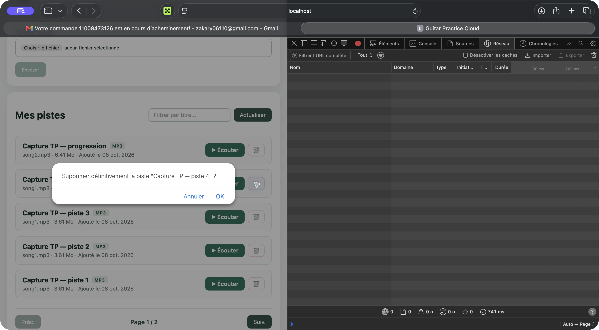

**Suppression suivie du rafraîchissement.** J’ai confirmé la suppression de ma piste temporaire de preuve. Network montre le DELETE en 204, puis le GET en 200 pour actualiser la bibliothèque. Je retrouve aussi le SnackBar de succès dans l’interface.

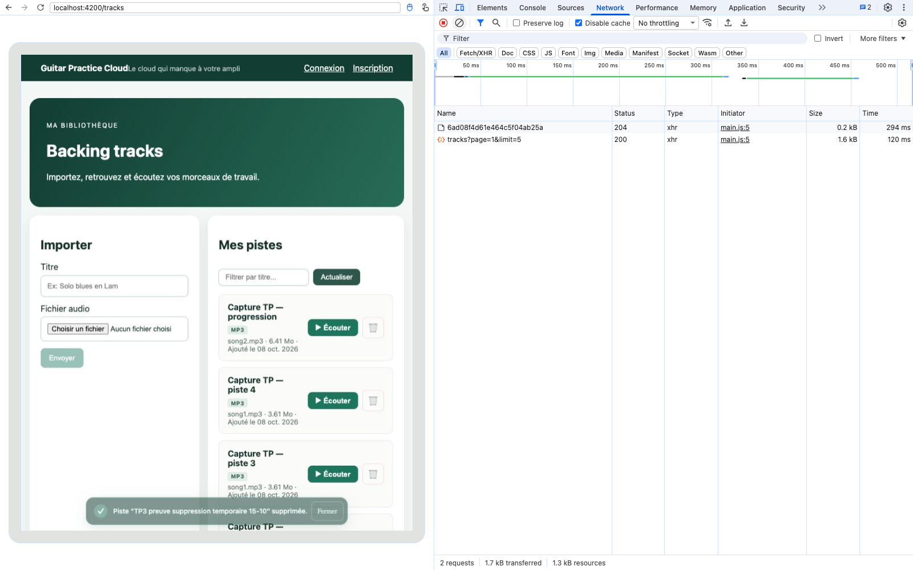

**Réponse du DELETE.** J’ai sélectionné la requête de suppression dans Network. Les détails montrent la méthode DELETE, l’URL de la piste et le statut 204 No Content. Ce statut confirme que l’API a terminé la suppression sans renvoyer de corps de réponse.

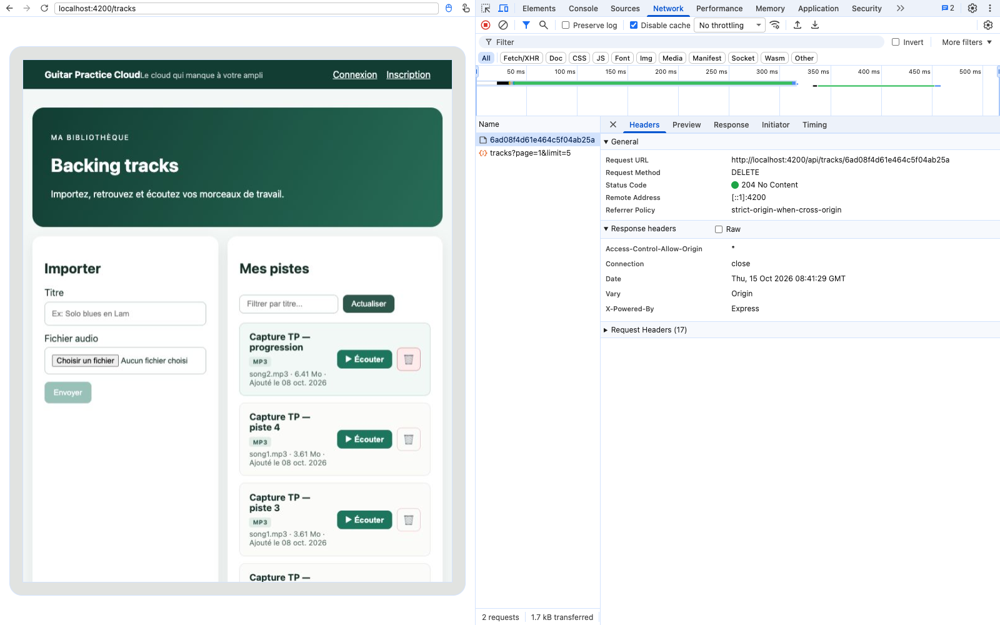

**Rechargement après suppression.** J’ai ouvert le GET envoyé après le DELETE. Le statut 200 et les paramètres de pagination montrent que le composant demande à nouveau la page au serveur. Cette requête permet de mettre la liste à jour après la suppression.

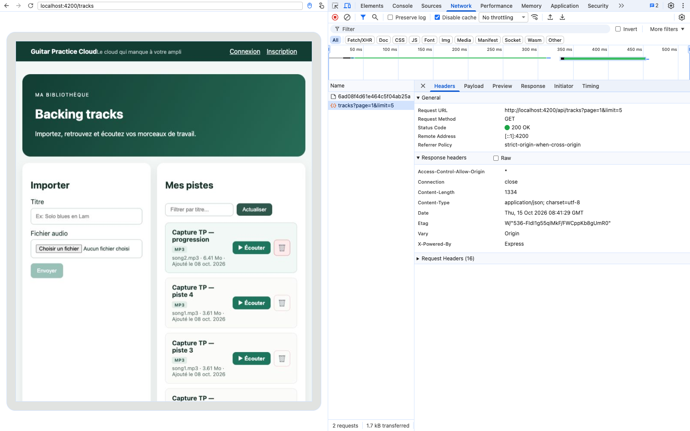

**Retour visible après suppression.** J’ai vérifié le message de succès affiché dans le SnackBar après la réponse du serveur. La notification confirme à l’utilisateur le résultat de l’action. Elle complète la preuve HTTP du DELETE, sans la remplacer.

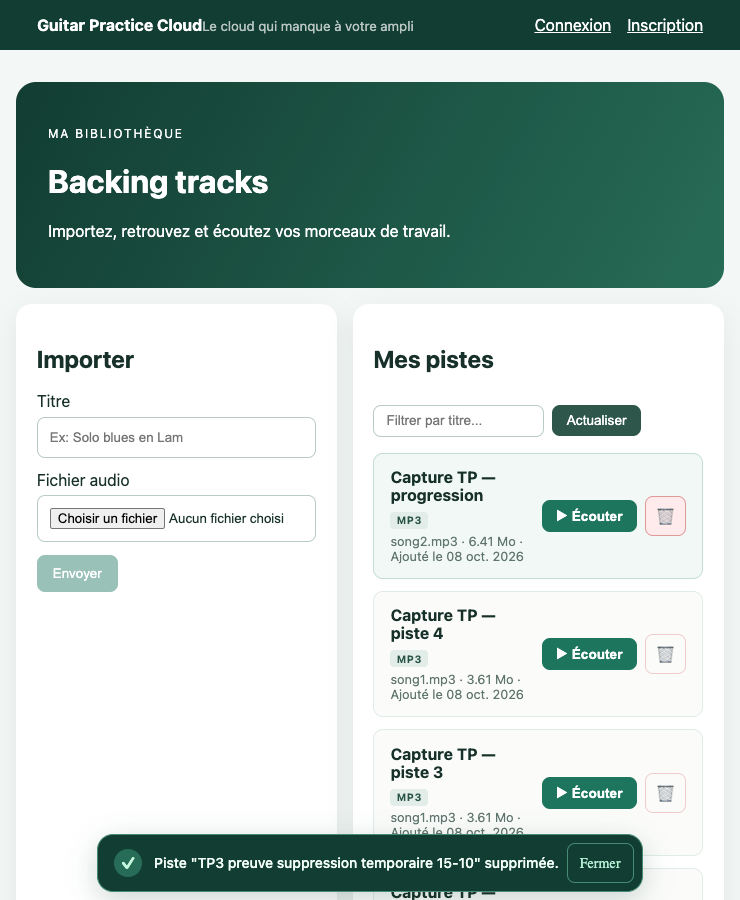

## Mission 6 : Progression de l’upload (TP3)

**Objectif.** Afficher la progression d’envoi, empêcher une seconde soumission et attendre la réponse du serveur avant d’annoncer le succès.

**Ce que j’ai demandé à l’IA.** Je lui ai demandé de réaliser la progression de l’upload.

**Exemple de prompt :**

> « Fais la mission 6 pour afficher la progression de l’upload. »

**Ce que j’ai obtenu.** J’ai fait évoluer l’upload avec l’aide de l’IA. `TrackService.upload()` conserve le multipart `audio` et `title`, avec `observe: 'events'` et `reportProgress: true`. `main.ts` configure `withXhr()` pour disposer des événements de progression d’upload. Le Signal `uploadProgress` est mis à jour à partir de `HttpEventType.UploadProgress`, avec le calcul `Math.round(100 * loaded / total)`. Si le total est inconnu, la barre reste indéterminée.

Pendant l’envoi, le titre, le fichier et le bouton sont désactivés. La méthode refuse une seconde soumission. `finalize` réactive les contrôles après succès ou erreur. Après un échec, le titre et le fichier restent disponibles pour réessayer.

**Distinction entre progression et réponse.** Une requête classique émet sa réponse finale. Avec `observe: 'events'`, il faut distinguer les événements de départ, de progression et de réponse. Un envoi à 100 % ne prouve pas que le serveur a accepté le fichier : seul `HttpEventType.Response` déclenche le succès, le vidage du formulaire et le rechargement de la page 1. Un pourcentage simulé avec un minuteur a donc été écarté.

**Comment j’ai vérifié.** J’ai testé un envoi réel dans mon navigateur. La capture de `song2.mp3` (6,41 Mo) montre une progression à 23 %, avec les contrôles désactivés. La réponse 201 a ensuite déclenché le message de succès, le vidage du formulaire et l’affichage de la piste en première position. Un relais HTTP local temporaire sur le port 4201 a ralenti le transfert vers Angular sur le port 4200 pour rendre la progression visible dans mon navigateur. Le fichier a été envoyé à l’API réelle, le relais a été arrêté après la vérification.

**Vérifications automatisées.** Les tests couvrent l’affichage à 25 %, l’attente de la réponse après 100 %, le blocage des contrôles, l’absence de total et un nouvel essai après une réponse 400.

**Fichiers concernés.** `src/main.ts`, `track.service.ts`, `tracks-page.ts`, `tracks-page.html` et `tracks-page.css`.

**Progression pendant le transfert.** J’ai envoyé `song2.mp3` avec un transfert ralenti pour rendre les étapes visibles. La capture montre 23 % et les contrôles désactivés pendant l’envoi. Ce pourcentage indique les octets transmis, il ne signifie pas encore que l’API a accepté la piste.

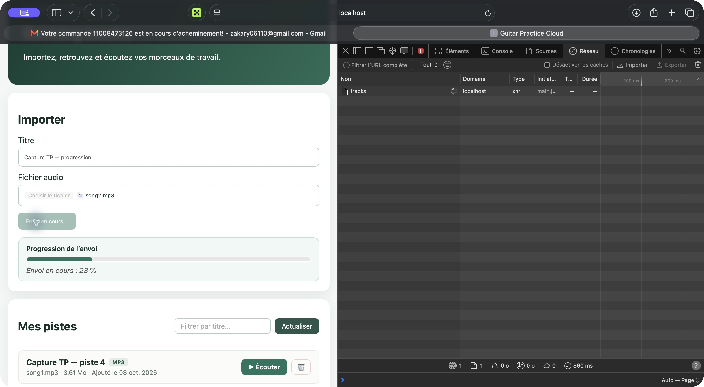

**Succès après acceptation par l’API.** J’ai attendu la réponse finale 201 de l’upload. La piste apparaît dans la bibliothèque, le message de succès est affiché et le formulaire est vidé. Je vérifie ainsi que le succès dépend de la réponse du serveur et pas seulement d’une progression à 100 %.

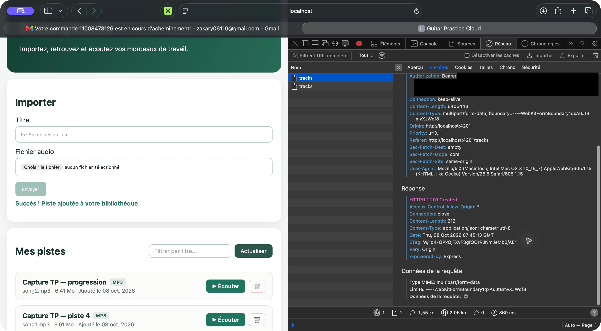

**Contrat conservé avec la progression.** J’ai ouvert le contenu du POST d’upload. Je retrouve les champs `audio` et `title`. L’ajout des événements de progression n’a donc pas changé le format multipart attendu par le backend.

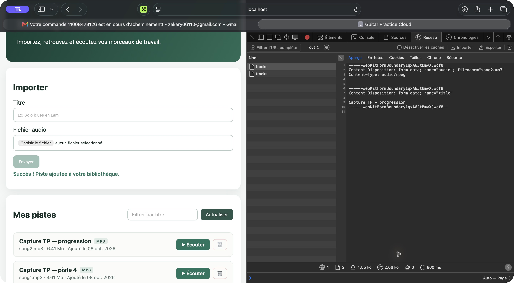

## Mission 7 : Tests automatisés (TP3)

**Objectif.** Tester le contrat HTTP et les états du composant sans dépendre d’un backend ni de MongoDB.

**Ce que j’ai demandé à l’IA.** Je lui ai demandé d’ajouter les tests et de m’indiquer comment les lancer.

**Exemple de prompt :**

> « Fais la mission 7 et dis-moi ce qu’il faut vérifier et comment tester. »

**Ce que j’ai obtenu.** Avec l’aide de l’IA, j’ai mis en place Angular/Vitest et jsdom, créé `tsconfig.spec.json` et ajouté deux tests de service et sept tests de composant. J’ai conservé les tests backend existants.

| Test frontend | Assertions principales |
|---|---|
| Pagination | Méthode GET, URL, paramètres page et limit, réponse restituée |
| Upload multipart | Méthode POST, URL, champs audio/title, progression demandée |
| Suppression | DELETE sur le bon identifiant, blocage du double appel, GET et notification après 204 |
| Annulation | Aucun DELETE, piste conservée |
| Piste absente ou inaccessible | Message après 404, liste actualisée et état libéré |
| Progression et succès | Affichage à 25 %, contrôles bloqués, attente après 100 %, succès après 201 |
| Erreur et nouvel essai | Total inconnu, erreur 400, formulaire conservé et nouvelle requête possible |

**Pourquoi les tests ne nécessitent-ils pas MongoDB ?** `HttpTestingController` intercepte les requêtes du service. Les tests fournissent les événements avec `event()` et les réponses avec `flush()`, puis vérifient les effets attendus. `http.verify()` contrôle l’absence de requêtes inattendues en attente.

Les tests du service ciblent le contrat HTTP. Ceux du composant combinent le template, les Signals et le service avec un transport simulé. Ils ne constituent pas une vérification de bout en bout de l’API et de MongoDB. Les tests d’intercepteur et de guard font partie des choix proposés dans le sujet, mais n’ont pas été ajoutés : les neuf tests retenus couvrent plus de trois scénarios parmi les options demandées.

**Difficulté rencontrée.** Lors du premier lancement avec l’assistant, le double de SnackBar n’était pas correctement utilisé. J’ai fait corriger sa configuration avec `TestBed.overrideProvider` pour remplacer le provider importé par Material. Après correction, les tests passent.

### Restitution : que vérifierait un test d’intercepteur ou de guard ?

Pour expliquer ces tests, je m’appuie sur le code de `frontend-starter/src/app/shared/interceptors/auth.interceptor.ts` et de `frontend-starter/src/app/shared/guards/auth.guard.ts`. Voici les assertions que je choisirais pour tester ces deux mécanismes.

**Intercepteur.** Un test vérifierait la requête après son passage dans `authInterceptor`, en configurant `provideHttpClient(withInterceptors([authInterceptor]))` et `provideHttpClientTesting()`. Avec un faux token de test dans `AuthService.token`, la requête doit avoir exactement le header `Authorization: Bearer <jeton-de-test>`. Sans token et sans header initial, elle ne doit pas ajouter Authorization. On vérifierait aussi que méthode, URL et corps sont conservés. Le transport serait intercepté par `HttpTestingController`, sans envoyer de JWT réel ni contacter le serveur.

Pour la gestion des erreurs, une réponse 401 simulée devrait appeler `auth.logout()` et `router.navigateByUrl('/login')`, tout en transmettant l’erreur à l’abonné. Une erreur 500 ne devrait pas déclencher cette déconnexion. Cela vérifie le comportement Angular, cela ne prouve pas que le backend valide correctement la signature des JWT.

**Guard.** Un test appellerait `authGuard` dans un contexte d’injection Angular, avec un `AuthService` contrôlé. Sans token, le résultat doit être un `UrlTree` dont la sérialisation vaut `/login`. Avec un token, le résultat doit être `true`. Dans ce code, le guard renvoie l’arbre de redirection : il n’appelle pas lui-même `navigateByUrl`. Il faut donc tester le résultat effectivement renvoyé, plutôt qu’attendre un appel de navigation inexistant.

La présence d’un token, même expiré ou invalide, suffit à ce guard pour autoriser la navigation. Sa validité est contrôlée ensuite par l’API, le 401 est traité par l’intercepteur. Un test de guard ne remplace donc jamais un test de sécurité serveur.

### Restitution : test unitaire ou test d’intégration ?

Un **test unitaire** cible le comportement d’une unité en contrôlant ses dépendances. Par exemple, `track.service.spec.ts` appelle le vrai `TrackService.list(2, 5)`, intercepte sa requête avec `HttpTestingController`, vérifie GET, URL et paramètres, puis injecte une réponse avec `flush()`. On vérifie ainsi le contrat HTTP du service sans démarrer Express ni MongoDB. Un test isolé de guard avec un service d’authentification contrôlé serait aussi un exemple.

Un **test d’intégration** vérifie la collaboration de plusieurs éléments réels. Dans `tracks-page.spec.ts`, le composant, son template, les Signals et `TrackService` fonctionnent ensemble, le transport HTTP est simulé et le SnackBar remplacé par un double. Par exemple, le test de suppression confirme l’action, observe le DELETE, fournit 204, observe le GET de rafraîchissement et contrôle la liste ainsi que la notification. C’est une intégration limitée au frontend, pas une preuve de fonctionnement de l’API ou de MongoDB.

Les contrôles réels du TP2, eux, font collaborer un client HTTP, Express, Mongoose, Atlas et les fichiers audio : ce sont des vérifications d’intégration de l’API. Les parcours manuels effectués dans Angular et le navigateur vérifient une chaîne plus complète, proche d’un test de bout en bout. Aucun de ces niveaux ne remplace les autres : les tests isolés localisent précisément une régression, tandis que les intégrations peuvent révéler un problème de configuration ou de données, comme un fichier audio absent sur disque.

**Résultats des dernières exécutions.** **9 tests frontend réussis sur 9**, **2 tests backend réussis sur 2**, build réussi. Je n’ai pas ajouté de test d’intercepteur ou de guard. Mes tests couvrent plus de trois scénarios frontend parmi les choix proposés dans le sujet. Le détail actuel figure en tête de [RAPPORT_TESTS_TP3.md](RAPPORT_TESTS_TP3.md).

**Comment j’ai vérifié.** J’ai lancé `npm test` dans le frontend et le backend, puis `npm run build` dans le frontend. J’ai obtenu les résultats suivants :

| Commande | Résultat |
|---|---|
| Frontend : `npm test` | 9 tests réussis sur 9, dans 2 fichiers, durée 3,49 s |
| Backend : `npm test` | 2 tests existants réussis sur 2 |
| Frontend : `npm run build` | Réussi |

Le message `[TracksPage] Envoi impossible 400` provient du scénario d’erreur simulée. Il est attendu et ne correspond pas à un échec de la suite. Le détail des résultats attendus et observés figure dans [RAPPORT_TESTS_TP3.md](RAPPORT_TESTS_TP3.md).

J’ai exécuté les tests et le build avec Node 24.21.0. Le build génère l’application dans `frontend-starter/dist/gpc`.

**Fichiers concernés.** `track.service.spec.ts`, `tracks-page.spec.ts`, `tsconfig.spec.json`, `tsconfig.app.json`, `angular.json`, `package.json`, `package-lock.json` et `RAPPORT_TESTS_TP3.md`.

## Vérifications finales et bilan (TP3)

Pour terminer, j’ai vérifié les principaux parcours de l’application dans mon navigateur : connexion, chargement du profil via l’API, pagination aller-retour, lecture audio, nettoyage du lecteur et suppression de la piste temporaire. J’ai également fait corriger le favicon manquant, qui provoquait une requête 404, en ajoutant une icône SVG dans `frontend-starter/src/index.html`.

Je me suis appuyé sur le journal de vérification pour contrôler la console : sur ces parcours, il ne contient aucune erreur ou exception JavaScript, aucun JWT et aucun mot de passe de démonstration. Le navigateur affiche une suggestion d’autocomplétion du formulaire, sans erreur d’exécution. Les messages et résultats sont conservés dans [le journal de vérification finale](captures/tp3-verifications-finales.json).

**Console après les parcours vérifiés.** J’ai consulté la console avec tous les niveaux de journalisation activés après les parcours du contrôle final. Sur cette séance, je ne retrouve ni erreur JavaScript inattendue ni donnée d’authentification dans les messages collectés. J’ai conservé le journal des messages affichés.

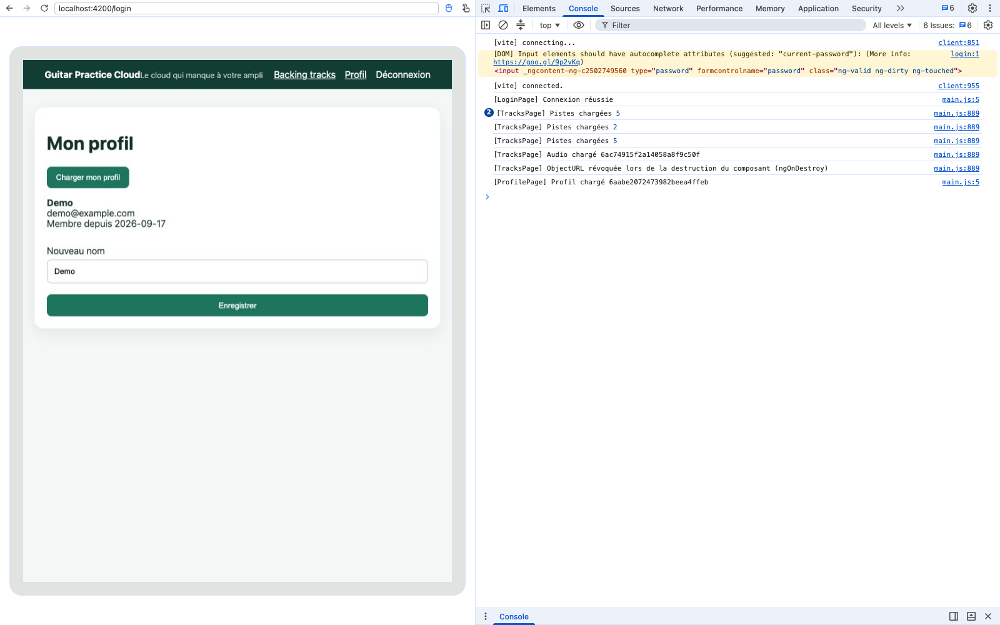

J’ai corrigé le favicon manquant et masqué les JWT sur les captures concernées. Les méthodes, les statuts HTTP et les champs multipart restent lisibles.

| Livrable TP3 | Résultat |
|---|---|
| Suppression | Implémentée, tests réussis, DELETE 204, GET 200 et SnackBar capturés |
| Progression de l’upload | Implémentée, progression, multipart et réponse 201 capturés |
| Tests frontend | 9 réussis sur 9 |
| Tests backend disponibles | 2 réussis sur 2 |
| Rapport des tests | Résultats attendus et observés consignés |
| Build | Réussi après la dernière correction |
| Captures Network | Suppression et upload documentés, JWT masqués |
| Console | Aucune erreur ni donnée d’authentification journalisée sur les parcours vérifiés |

**Limites de mes vérifications.** Je n’ai pas testé manuellement la suppression depuis deux onglets ni la panne du backend pendant un upload lors du contrôle final. Les comportements associés aux réponses 404 et aux erreurs d’upload sont couverts par des tests automatisés avec réponses simulées. Les deux tests backend existants ne suffisent pas à valider toute la sécurité de l’API.
